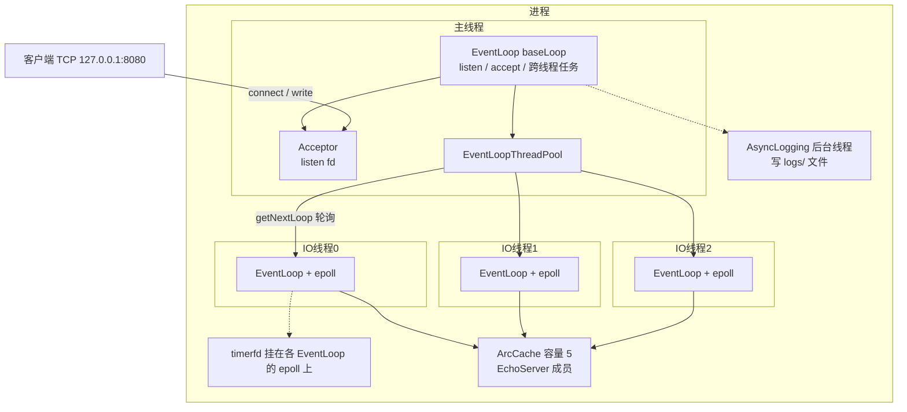
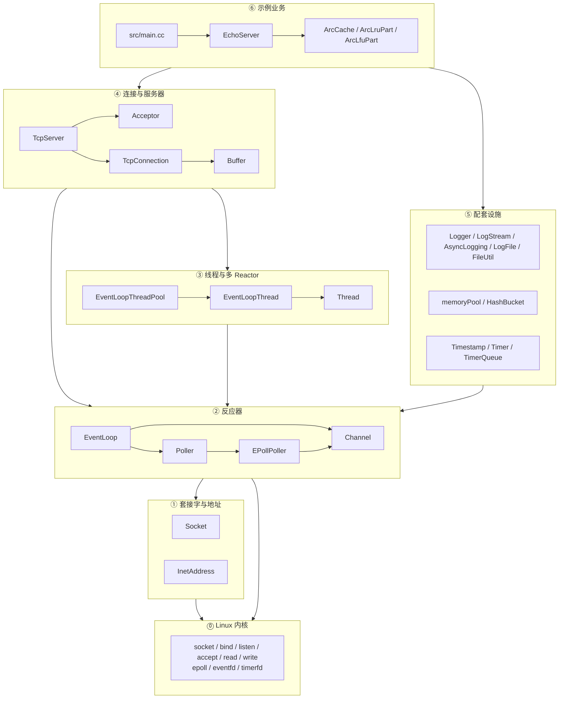
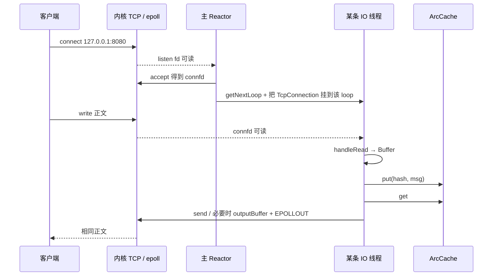

# KeeServer

学习型、muduo 风格的 **Linux 多 Reactor TCP 网络库**，示例业务是运行在 `127.0.0.1:8080` 上的 **Echo 服务器**（带 ARC 缓存）。它不是 HTTP/Web 服务器：客户端用 TCP 发来的字节，服务器从缓存取出后原样发回。

核心模型是 **one loop per thread**：主线程（主 Reactor）只负责 `listen/accept`，三条 IO 线程各自拥有一个 `EventLoop`，用 epoll 处理已建立连接上的读写。

---

## 环境要求

- Linux（使用 `epoll`、`eventfd`、`timerfd`、`timerfd_create`）
- C++17 编译器（CMake 中 `CMAKE_CXX_STANDARD 17`）
- CMake ≥ 3.10
- pthread

---

## 编译

在仓库根目录（有顶层 `CMakeLists.txt` 的目录）执行：

```bash
cmake -S . -B build
cmake --build build
```

- 第一句只生成构建系统，不编译。
- 第二句编译静态库 `keeserver`、示例程序 `main` 以及全部 `test_*`。
- 产物都在 `build/` 下。当前目录如果已经是 `build/`，测试程序写成 `./test_echo`，不要再加一层 `build/`。

只编示例服务器：

```bash
cmake --build build --target main
```

---

## 运行 Echo 服务器

```bash
./build/main
```

启动后主线程进入 `EventLoop::loop()`，一直 `epoll_wait`，直到进程被结束（例如 Ctrl+C）。

| 项 | 值 |
|----|-----|
| 监听地址 | `127.0.0.1:8080`（`InetAddress(8080)` 默认 IP 是 `127.0.0.1`） |
| IO 线程 | 3（`EchoServer` 里 `setThreadNum(3)`），外加主线程这一台 Reactor |
| ARC 缓存容量 | 5 |
| 定时心跳 | 每 5 秒一条 `LOG_INFO` |
| 内存池 | `main` 里 `initMemoryPool` 后用 `newElement` 做一次探测，请求路径上的 Echo 仍用普通 `std::string` |

另开终端自测：

```bash
nc 127.0.0.1 8080
```

输入一行后应原样返回。内部路径是：把正文 `put` 进 `ArcCache`，再 `get` 出来 `send`，不是绕过缓存直接回。

### 日志

启动时会创建目录 `logs/`（已存在则忽略）。异步日志文件名为：

```text
logs/<程序名>
```

用 `./build/main` 启动时，一般是 `logs/main`（`basename(argv[0])`）。滚动大小 `1MB`（`kRollSize`），后台线程最多约 3 秒刷一次。当前 `setOutput` 会同时：

1. `fwrite` 到终端
2. `AsyncLogging::append` 进文件

---

## 运行测试

先保证 `cmake --build build` **整次编完**。中途某个目标失败时，后面的 `test_*` 可能仍是旧二进制，不要混着看结果。

一次性跑当前 CMake 里的全部测试（在仓库根目录）：

```bash
cmake --build build && \
for t in \
  test_eventloop test_channel test_pipe test_socket test_acceptor test_buffer \
  test_connection test_echo test_wakeup test_threadpool test_send test_timer \
  test_log test_asynclog test_mempool test_cache_used test_conncb test_logfile \
  test_shutdown test_writecomplete test_highwater test_sendfile
do
  echo "===== $t ====="
  ./build/$t || exit 1
done
```

只跑某一个：

```bash
cmake --build build --target test_echo
./build/test_echo
```

成功时对应程序打印 `OK`（或 `ok`，见 `test_timer`）。

| 程序 | 验证什么 |
|------|----------|
| `test_eventloop` | `loop()` 会阻塞，另一线程 `quit()` 后能返回 |
| `test_channel` | 兴趣掩码与 `handleEvent` 按 `revents` 分发读/写/关闭 |
| `test_pipe` | 匿名管道 + `enableReading` 后对端 `write` 能触发读回调 |
| `test_socket` | `InetAddress` 往返、`bind/listen/connect/accept`、已建立连接能读到字节 |
| `test_acceptor` | 构造不 `listen`；`listen` 后可读事件进 `handleRead`，回调拿到 `connfd` |
| `test_buffer` | 用户态缓冲 `append/retrieve`、`readFd`（含 `readv` + 栈上 extrabuf） |
| `test_connection` | `TcpConnection` 建立后 echo 小包 |
| `test_echo` | `TcpServer` 默认单 Reactor 的 echo |
| `test_wakeup` | 跨线程 `runInLoop` 靠 `eventfd` 叫醒 `epoll_wait` |
| `test_threadpool` | `numThreads=0` 退回主 loop；`=2` 时轮询且任务跑在不同 OS 线程 |
| `test_send` | 小套接字缓冲 + 大包，走 `outputBuffer_` + `EPOLLOUT` 分次写完 |
| `test_timer` | `runAfter` 按时间顺序；`runEvery` 周期三次；靠 `timerfd` 而不是 10s 超时 |
| `test_log` | `LOG_INFO <<` 流式拼接，析构冲刷，`setOutput` 可截获 |
| `test_asynclog` | 日志经后台线程落入真实文件，`stop()` 后能读到 |
| `test_logfile` | `LogFile` 按大小滚动出第二个文件 |
| `test_mempool` | 小块 bump/空闲链表 LIFO、大于 512 走系统堆、`newElement` 会调构造 |
| `test_cache_used` | `EchoServer` 内 `ArcCache` 的 put/get，以及 echo 路径会写入这份缓存 |
| `test_conncb` | 连接建立/断开时 connection 回调会触发 |
| `test_shutdown` | `shutdownWrite` 后对端 `read` 得到 0 |
| `test_writecomplete` | 发送完成回调在数据写出去之后触发 |
| `test_highwater` | 输出缓冲涨过水位线时触发高水位回调 |
| `test_sendfile` | `sendFile` 把临时文件内容送到客户端 |

---

## 总体架构

主线程跑 **baseLoop**（主 Reactor）：只盯 listen fd，`accept` 出新连接后交给线程池 **round-robin** 分到某条 IO 线程。每条 IO 线程是一个 `EventLoopThread`：**一线程一个 EventLoop、一个 epoll 实例**，负责该线程上所有 `connfd` 的读写、定时器和投递过来的函数。



配套能力（不占独立 Reactor，挂在现有循环或独立线程上）：

- **定时器**：每条 `EventLoop` 一个 `TimerQueue`、一个 `timerfd`，用户态 `set` 按到期时间排序。
- **日志**：调用线程拼行（`LogStream`），`Logger` 析构交给 `g_output`；`main` 里接到异步日志（终端 + 文件）。
- **内存池**：64 口固定槽宽（8～512 字节）+ 空闲链表；`main` 里初始化并探测一次。
- **缓存**：`KeeCache::ArcCache`（LRU + LFU + 幽灵链表），Echo 收包后 put/get。

---

## 分层架构

从上到下，每一层只回答一个问题。上层通过回调使用下层，不直接 `epoll_ctl`。



### ⓪ 内核

用户态只发系统调用。TCP 握手、套接字发送/接收缓冲、listen 全连接队列、epoll 兴趣列表与就绪列表都在内核。`accept` 不取应用数据，只取出一条已建立连接的新 fd。

### ① 套接字与地址

| 类 | 职责 |
|----|------|
| `InetAddress` | 封装 `sockaddr_in`，IP/端口与网络字节序互转 |
| `Socket` | RAII 包着 fd：`socket/bind/listen/accept`、`SO_REUSEADDR` 等，析构 `close` |

### ② 反应器（Reactor）

| 类 | 职责 |
|----|------|
| `Channel` | 一张 fd 的登记卡：兴趣掩码 `events_`、就绪掩码 `revents_`、读/写/关闭回调 |
| `Poller` | 抽象：`poll` / `updateChannel` / `removeChannel`，用户态 `channels_` 表 |
| `EPollPoller` | Linux 实现：`epollfd_`、`epoll_wait` 填 `events_`、`epoll_ctl` ADD/MOD/DEL |
| `EventLoop` | 一条线程的值班循环：`poll` → `handleEvent` → `doPendingFunctors`；`eventfd` 跨线程唤醒；持有 `TimerQueue` |

`enableReading()` 只改兴趣并 `epoll_ctl`；真正回调发生在之后某次 `epoll_wait` 返回。

### ③ 线程与多 Reactor

| 类 | 职责 |
|----|------|
| `Thread` | 延迟 `start()` 的 `std::thread` 包装；析构时未 `join` 则 `detach` |
| `EventLoopThread` | 新线程栈上造 `EventLoop`，`startLoop` 等到指针非空再返回 |
| `EventLoopThreadPool` | `numThreads==0` 时 `getNextLoop` 退回 `baseLoop`；否则 round-robin |

这是 IO 线程池（每线程一个 epoll），不是用来算 CPU 任务的计算线程池。

### ④ 连接与服务器

| 类 | 职责 |
|----|------|
| `Acceptor` | 只处理 listen fd：可读则 `accept`，把 `connfd` 交给 `newConnectionCallback` |
| `Buffer` | 用户态字节缓冲：`readFd`/`writeFd`、`retrieve`；内核缓冲仍在套接字对象里 |
| `TcpConnection` | 一根已建立连接：输入缓冲、输出缓冲、`send`/`handleWrite`、状态机 |
| `TcpServer` | 持有 `Acceptor` + 线程池 + 连接表；`newConnection` 里按 `getNextLoop()` 把连接挂到对应 IO 线程 |

发送路径：能写就 `::write`；写不完进 `outputBuffer_` 并 `enableWriting`，`EPOLLOUT` 时 `handleWrite` 继续冲。

### ⑤ 配套设施

| 模块 | 职责 |
|------|------|
| `Timestamp` / `Timer` / `TimerQueue` | 时间点、一只闹钟、一个 `timerfd` 对准队头 |
| `LogStream` / `Logger` | 固定小缓冲流式拼行，宏展开为临时对象，析构输出 |
| `FileUtil` / `LogFile` / `AsyncLogging` | `FILE*` 追加、按大小滚动、前端内存队列 + 后台写盘 |
| `memoryPool` | 按 8 字节档选池，大块 bump + 空闲链表头插；`>512` 走 `operator new` |

### ⑥ 示例业务

| 类 | 职责 |
|----|------|
| `EchoServer` | 登记连接/消息回调，`setThreadNum(3)`，消息进入 `ArcCache` 再 echo |
| `ArcCache` | LRU + LFU + 幽灵命中时两边借容量 |
| `src/main.cc` | 异步日志、内存池探测、绑 8080、5 秒心跳、进入 `loop()` |

---

## 一次 Echo 请求（逻辑顺序）



用户态不解释 TCP 段，只处理「这个 fd 就绪了」。数据在 `read` 之前一直在内核接收缓冲里。

---

## 目录结构

```text
KeeServer/
├── CMakeLists.txt
├── include/          公共头文件（Reactor、连接、日志、池、缓存、EchoServer）
├── src/              对应实现；main.cc 为示例进程入口
├── tests/            分层测试
└── build/            编译产物（CMake 生成，勿提交）
```

头文件与实现按模块一一对应，例如 `EventLoop.h` ↔ `EventLoop.cc`。缓存（`ArcCache.h` 等）目前是头文件模板，无单独 `.cc`。

---

## 构建产物关系

```text
src/*.cc  ──►  库 keeserver (链接 pthread)
                 │
                 ├── build/main              示例 Echo 进程
                 └── build/test_*            各层测试
```
